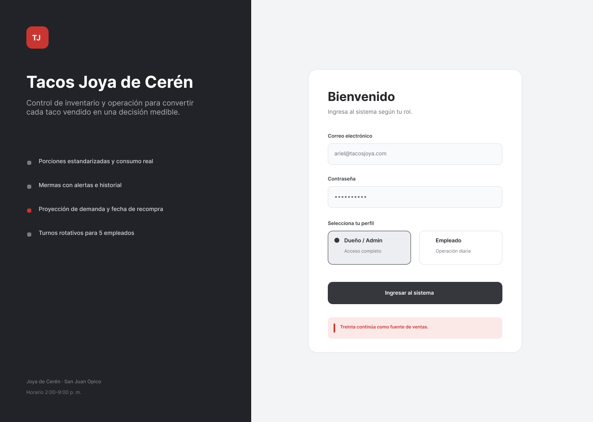
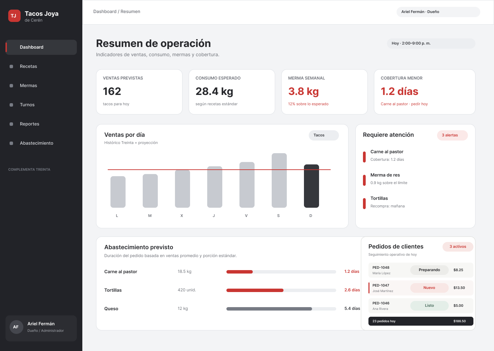
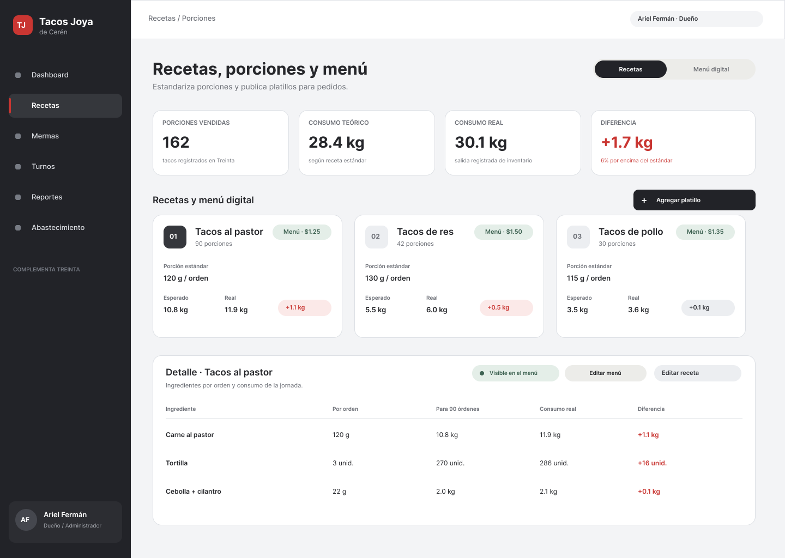
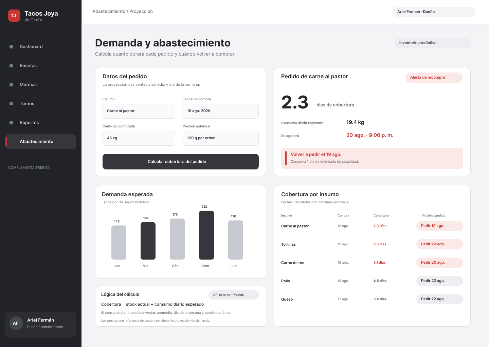
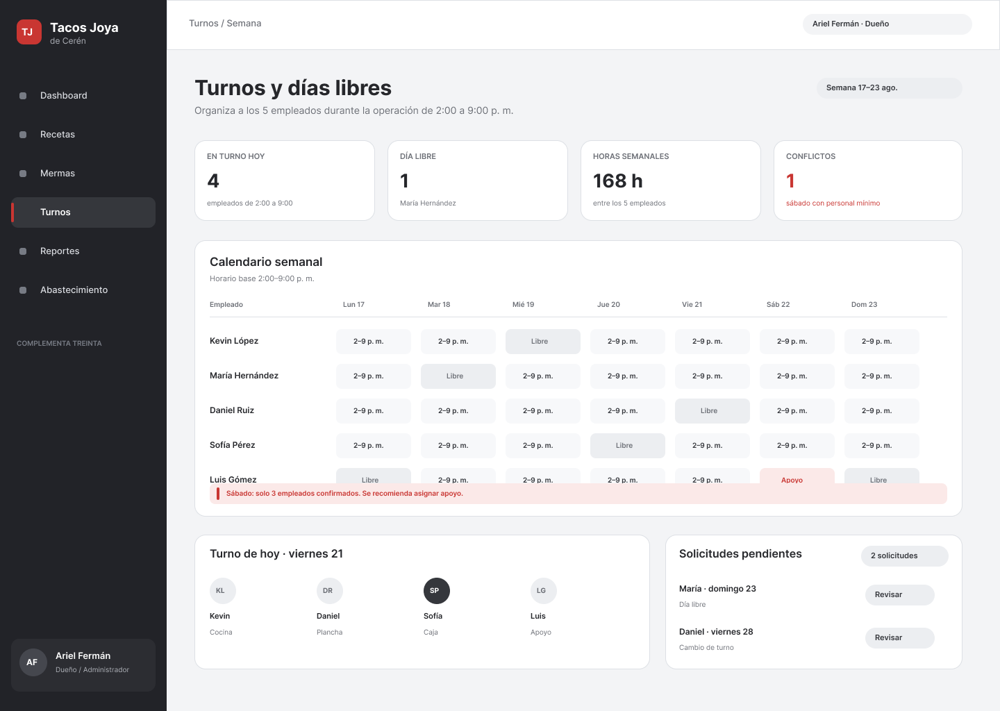
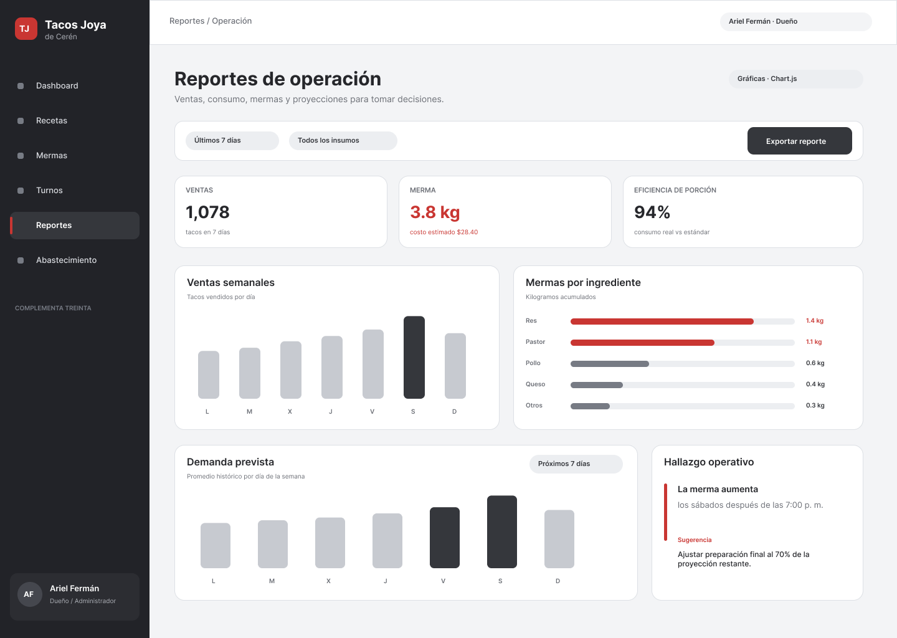
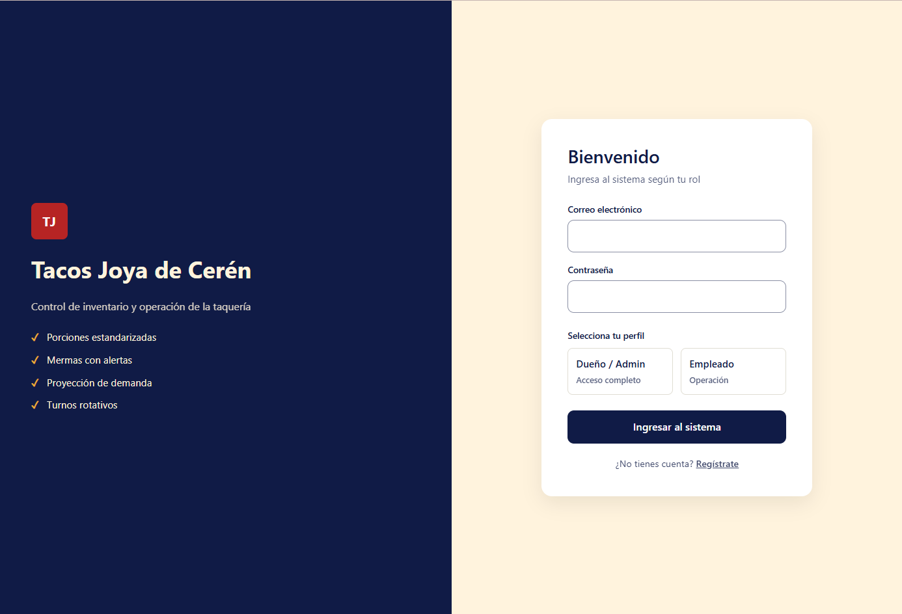
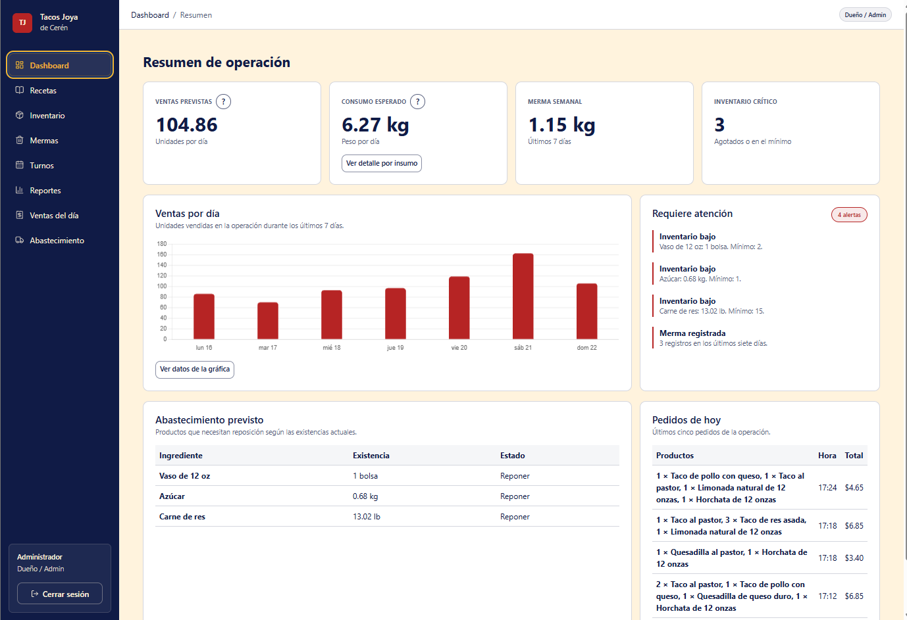
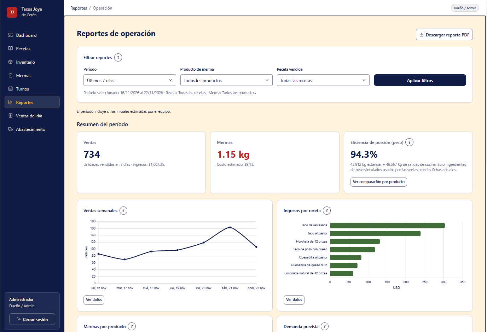
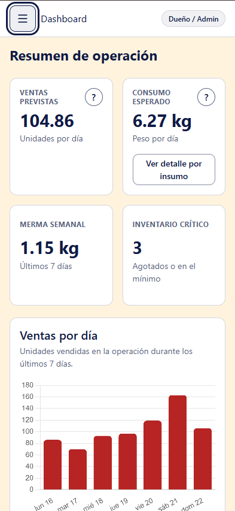

# Tacos Joya de Cerén

[](https://creativecommons.org/licenses/by-nc-sa/4.0/deed.es)
[](https://jexxe0012.github.io/tacos-joya-de-ceren/)

Aplicación web de gestión interna para Tacos Joya de Cerén, un restaurante mexicano de origen familiar en El Salvador. Proyecto de cátedra de **Desarrollo de Aplicaciones Web con Software Interpretados en el Cliente (DAW901)**, UDB Virtual, ciclo II 2026.

**Aplicación publicada:** https://jexxe0012.github.io/tacos-joya-de-ceren/

## Contenido

- [Entrega final](#entrega-final)
- [Video de presentación](#video-de-presentación)
- [Problema que resuelve](#problema-que-resuelve)
- [Mockups en Figma](#mockups-en-figma)
- [Capturas de la aplicación](#capturas-de-la-aplicación)
- [Cumplimiento de requisitos](#cumplimiento-de-requisitos)
- [Descripción técnica](#descripción-técnica)
- [Roles](#roles)
- [Módulos](#módulos)
- [Arquitectura y datos](#arquitectura-y-datos)
- [Tecnologías y ejecución](#tecnologías-y-ejecución)
- [Equipo y trabajo colaborativo](#equipo-y-trabajo-colaborativo)
- [Licencia](#licencia)

## Entrega final

Etapa 3, entrega final: aplicación completa desplegada (domingo 22 de noviembre de 2026). Defensas en la semana del 23 al 27 de noviembre.

- [Aplicación web publicada en GitHub Pages](https://jexxe0012.github.io/tacos-joya-de-ceren/)
- [Repositorio público](https://github.com/Jexxe0012/tacos-joya-de-ceren)
- [Mockups del proyecto](#mockups-en-figma)
- [Licencia Creative Commons](LICENSE)
- [Video de presentación del proyecto](https://drive.google.com/drive/folders/1jlA-R0OKAl2I3OH-aHZRYvmw7MtYIXdt?usp=sharing)

## Video de presentación

En este video, Diego, Alexander y Josué presentamos Tacos Joya de Cerén de principio a fin: el problema del negocio y el diseño,
los perfiles de administrador y empleado, la operación diaria de la taquería y cómo esa información llega a los reportes
y al abastecimiento. Es el recorrido completo de la aplicación como parte de la entrega final.

**Enlace del video:** https://drive.google.com/drive/folders/1jlA-R0OKAl2I3OH-aHZRYvmw7MtYIXdt?usp=sharing

## Problema que resuelve

La aplicación reúne la operación del restaurante en un solo lugar: estandariza las recetas con fichas técnicas, organiza los turnos del personal, registra ventas y mermas, y convierte esos registros en reportes y en una proyección de abastecimiento.

La paleta compartida de crema, azul, rojo, amarillo maíz y verde representa tradición, familia y responsabilidad.

## Mockups en Figma

Diseños elaborados en la Etapa 1 y usados como guía para la interfaz final.

**Archivo de Figma:** [Ver mockups en Figma](https://www.figma.com/design/SQLfj8FCplVre7ZpxU2lRi/Tacos-Joya-de-Cer%C3%A9n-%E2%80%93-Mockups-web?node-id=0-1)

| Inicio de sesión | Dashboard |
| --- | --- |
|  |  |

| Recetas | Abastecimiento |
| --- | --- |
|  |  |

| Turnos | Reportes |
| --- | --- |
|  |  |

## Capturas de la aplicación

Vista final implementada en React, para comparar con los mockups.

| Inicio de sesión | Dashboard (administrador) |
| --- | --- |
|  |  |

| Reportes con gráficas | Vista móvil |
| --- | --- |
|  |  |

## Cumplimiento de requisitos

| Requisito del proyecto | Dónde se cumple |
| --- | --- |
| Mínimo 5 vistas navegables | Login, Registro, Dashboard, Recetas, Inventario, Mermas, Turnos, Ventas del día, Reportes y Abastecimiento (`src/app/Rutas.jsx`). |
| Mínimo 2 roles con permisos diferenciados | Administrador y Empleado, con rutas protegidas por rol (`src/auth/RutaProtegida.jsx`). |
| Consumo de API externa | Open-Meteo, pronóstico de 7 días en Reportes y Abastecimiento (`src/services/climaService.js`). |
| Reportes con gráfica dinámica | Chart.js en Dashboard y Reportes, con filtros por período, receta y producto, y descarga en PDF. |
| Framework JS | React con Vite y React Router en toda la aplicación. |
| Mínimo 3 módulos con lógica de negocio | Costos y márgenes de recetas, movimientos de inventario, mermas con descuento de existencias, cruces de turnos, demanda proyectada y cobertura de abastecimiento. |
| Validación de entradas | Todos los formularios validan junto a cada campo (`src/utils/validaciones.js`, `src/hooks/useFormulario.js`). |
| Manejo de sesiones | Sesión y bloqueo por intentos fallidos en `localStorage` (`src/services/authService.js`). |
| Sin credenciales ni API keys expuestas | Open-Meteo no requiere API key. El repositorio no contiene archivos `.env` ni llaves privadas. Las cuentas de este README son de demostración. |
| Despliegue en hosting gratuito | GitHub Pages mediante GitHub Actions (`.github/workflows/pages.yml`). |
| Mockups en el README | Sección [Mockups en Figma](#mockups-en-figma). |
| Licencia Creative Commons | Archivo [LICENSE](LICENSE) y sección [Licencia](#licencia). |

## Descripción técnica

En la Etapa 3 la aplicación migró a **React con Vite y Bootstrap**: una entrada en `index.html`, un árbol React y navegación con `HashRouter`. Los módulos comparten las colecciones cargadas desde el JSON inicial.

### Cómo funciona

1. El enlace principal abre el login, incluso si hay una sesión guardada. Inicia sesión con correo, contraseña y perfil. El registro de administrador solicita una clave de demostración adicional.
2. Después de validar las credenciales, el administrador entra a **Dashboard** y el empleado a **Mis turnos**. Las rutas comprueban la sesión y el rol.
3. La plantilla `AppLayout` comparte Sidebar, Header y contenido. La navegación cambia de módulo dentro de React y el menú se adapta a móvil.
4. Los formularios muestran sus validaciones junto a los campos. SweetAlert2 centraliza las confirmaciones, errores y avisos.
5. Los módulos guardan mediante `db`, y `useColeccion` recibe sus cambios y los de otras pestañas. Las operaciones de varias escrituras se agrupan con `db.enLote`.
6. Cerrar sesión pide confirmación y conserva los registros del negocio.

## Roles

| Perfil | Funciones |
| --- | --- |
| Administrador | Acceso a todos los módulos; gestión de recetas, inventario y turnos; movimientos, mermas y ventas; solicitudes de empleados, Reportes y Abastecimiento. |
| Empleado | Mis turnos, consulta de Recetas e Inventario, registro de Ventas del día y Mermas, y solicitudes de días libres. |

El menú del empleado conserva este orden: **Mis turnos, Recetas, Ventas del día, Inventario y Mermas**. Dashboard, Reportes y Abastecimiento redirigen al inicio del empleado cuando intenta abrirlos directamente.

## Módulos

### Autenticación

`AuthProvider` comparte la sesión con `useAuth`. `RutaPublica` y `RutaProtegida` controlan la navegación. El servicio conserva las cuentas de demostración, el registro por roles y el bloqueo temporal tras intentos fallidos. La sesión usa `{ id, correo, nombre, rol, loginAt }`.

### Dashboard

Consulta las ventas reales de los últimos siete días, las recetas actuales, las mermas y el inventario. Presenta promedio diario de ventas como previsión, consumo esperado por insumo, merma con peso conocido, productos críticos, gráfica semanal, alertas y pedidos del día. El consumo se estima con las porciones e ingredientes de las fichas actuales y la mezcla de ventas registrada. Las demás unidades se detallan por separado; las fichas incompletas producen una estimación parcial. Sin ventas reales no inventa una previsión de 162 unidades.

### Recetas y fichas técnicas

Búsqueda por nombre o ingrediente y filtros por categoría, estado y orden. El administrador crea, edita y elimina recetas, y consulta costos y márgenes; el empleado consulta la ficha, ingredientes, rendimiento y preparación. Los insumos y sus costos de referencia proceden del catálogo común `insumosService`.

### Ventas del día

Permite registrar pedidos con varias recetas activas, cantidades enteras de 1 a 500 y método de pago. Valida una fecha local no futura de hasta siete días atrás y confirma el total antes de guardar. Cada línea conserva nombre, precio y total de la venta; las líneas de un pedido comparten `pedidoId`. El historial, indicadores y gráfica por producto se actualizan desde los registros. Solo el administrador puede eliminar las ventas de una fecha, con confirmación.

### Inventario

Productos con categoría, unidad, existencia, mínimo, costo, proveedor, ubicación y caducidad. El administrador gestiona productos, entradas, salidas y ajustes; consulta historial y alertas. El empleado dispone de búsqueda y consulta de existencias. `aplicarMovimiento` guarda producto y movimiento juntos y conserva la unidad del movimiento.

### Mermas

Registra producto, cantidad perdida, motivo, responsable y observaciones. Valida que la pérdida no exceda las existencias. Tanto Mermas como el registro rápido de Turnos usan `registrarMerma`: descuenta el producto, registra la salida por «Merma o desperdicio» y guarda la merma en un lote compartido.

### Turnos y solicitudes

El administrador organiza turnos semanales, estaciones y recurrencias, comprueba cruces y responde solicitudes de días libres. El empleado consulta su calendario, registra una merma rápida y envía solicitudes con seguimiento de estado.

### Reportes de operación

Disponible para administradores. Consulta las colecciones de la app mediante `db` y `useColeccion`. Las consultas incluyen la base inicial y los registros agregados durante el uso de la página. Incluye:

- Filtros de últimos 7 o 30 días, o rango personalizado de hasta 90 días inclusive. Valida fechas existentes, orden correcto y ausencia de fechas futuras.
- Filtro de receta vendida obtenido del catálogo de Recetas: tacos, bebidas y complementos. También permite consultar recetas inactivas y ventas históricas de recetas eliminadas. Crear una receta no registra ventas.
- Filtro independiente de producto de merma, obtenido de Inventario y de los registros históricos.
- Unidades vendidas e ingresos registrados, gráfica diaria de líneas e ingresos por receta en barras horizontales. Los períodos largos conservan cada día con desplazamiento interno.
- Mermas por producto, con alternancia entre kg y USD y tablas de cantidades en su unidad original. Convierte kg, g y lb; no convierte litros, unidades o empaques a peso sin una equivalencia conocida. El costo se estima con el costo unitario actual de Inventario, convirtiendo unidades compatibles.
- Demanda para los 7 días posteriores al período, calculada con el promedio de ventas registradas de cada día de la semana. La ausencia de registros se muestra como «Sin datos», sin inventar ventas de cero.
- Hallazgo operativo que identifica el producto con mayor merma conocida en kg y contempla empates, registros ausentes y unidades sin conversión.
- Descarga PDF con marca, período, fecha local, usuario, filtros aplicados, indicadores, tablas y gráficas. Exporta el reporte aplicado, aunque los campos se hayan editado después; divide las series extensas en partes legibles. El nombre es `reporte-tjc-AAAA-MM-DD.pdf`.

La receta seleccionada filtra ventas, ingresos y demanda. El producto seleccionado filtra las mermas y el hallazgo de forma independiente: las mermas todavía no se pueden atribuir a una receta. Los registros inválidos se omiten con aviso; los pesos o costos incompletos se indican como parciales y las cifras iniciales se identifican como estimaciones en pantalla y en el PDF.

La eficiencia de porción en peso compara **kg estándar de las ventas ÷ kg de salidas por «Consumo en cocina» × 100**, con las fichas de recetas actuales. Usa únicamente los ingredientes de peso vinculados que intervienen en las ventas del período. No suma litros o unidades con kg, no utiliza las mermas como consumo de cocina y no interpreta una falta de registros como consumo de cero. Si falta una ficha, vínculo, equivalencia o salida necesaria, muestra «Sin datos» con la causa. Incluye una comparación por producto en pantalla y PDF.

En **Conectar ingredientes de Recetas con Inventario**, el administrador elige la correspondencia entre IDs, sin cambiar recetas ni existencias. Las conversiones kg/g/lb, litros/ml y docenas/unidades se calculan automáticamente. Los empaques o densidades exigen indicar una equivalencia real; no se adivinan por nombre. Cada producto se vincula a un solo ingrediente. Guardar o quitar un vínculo actualiza el reporte aplicado y el PDF mediante las suscripciones compartidas.

Las salidas de Inventario identifican el producto y el motivo, pero no la receta: la eficiencia requiere seleccionar **Todas las recetas**. El filtro de producto sí delimita la comparación. Los nuevos movimientos conservan su unidad; los antiguos usan la unidad actual de Inventario y generan un aviso. Si se cambia la unidad de un producto vinculado, se debe revisar y guardar de nuevo la equivalencia.

### Abastecimiento

Simula consumo diario, cobertura, agotamiento y recompra con un día de seguridad. Usa el promedio de unidades vendidas en los últimos siete días. Cuando el período está vacío, muestra una serie de referencia identificada en la gráfica. Valida fecha de compra no futura de hasta 30 días atrás, cantidad entre 0.1 y 5000 en incrementos de 0.1 y porción entre 0.001 y 10 en incrementos de 0.001. Una cobertura inferior a tres días muestra una alerta.

Las cantidades y porciones iniciales del simulador son **referencias editables**. La pantalla lo aclara: no registra compras ni modifica las existencias de Inventario. El consumo por unidad vendida debe ajustarse a la mezcla de productos que se planifica.

### API externa: Open-Meteo

Reportes y Abastecimiento muestran siete días de temperatura mínima y máxima y probabilidad de lluvia para la ubicación del restaurante confirmada por el equipo: latitud `13.8225036`, longitud `-89.3608276`, zona `America/El_Salvador`.

El servicio valida la respuesta, cancela consultas al desmontar, establece un límite de tiempo y reutiliza el resultado durante 15 minutos. La interfaz muestra carga, datos ausentes, fallo, reintento, momento de consulta, ubicación y atribución. **El clima sirve como contexto de planificación; la demanda continúa calculándose desde las ventas.** Un fallo del proveedor permite seguir consultando los registros.

Fuentes: [documentación de Open-Meteo](https://open-meteo.com/en/docs) y [ubicación suministrada](https://maps.app.goo.gl/frPASAN69BMa8bAE7).

## Arquitectura y datos

| Ruta | Responsabilidad |
| --- | --- |
| `index.html`, `src/main.jsx`, `src/App.jsx` | Entrada, único `createRoot`, arranque, AuthProvider y HashRouter. |
| `src/app/` | Rutas, catálogo del menú e inicialización. |
| `src/components/layout/` | AppLayout, Sidebar y Header compartidos por rol. |
| `src/components/` | Ventanas, gráfica de barras y clima reutilizables. |
| `src/auth/` | Sesión y protección de rutas. |
| `src/hooks/` | Colecciones reactivas y formularios. |
| `src/services/` | Persistencia, autenticación, diálogos, catálogo y API. |
| `src/utils/` | Fechas locales y validaciones importables. |
| `src/modulos/` | Auth, Dashboard, Recetas, Ventas, Inventario, Mermas, Turnos, Reportes y Abastecimiento. |
| `css/main.css`, `css/` | Paleta común y estilos de módulos. |

Cada carga de la app parte del mismo [JSON inicial](src/datos/operacion-inicial.json). Contiene 14 días de ventas, recetas, inventario, movimientos, mermas y turnos, con cifras estimadas por el equipo. Las fechas del historial se trasladan al período que termina el día de la carga.

Una venta guarda `fecha` local, `hora`, `pedidoId`, `recetaId`, `recetaNombre`, `cantidad`, `precioUnitario`, `total`, `metodoPago`, `registradoPor` y `creadoEn`. Los registros de la base inicial llevan `origen: "base-inicial"`. El total corresponde a esa línea y no se recalcula si cambia la receta. `fechaHoyLocal()` determina el día de negocio; `toISOString()` se reserva para marcas de tiempo.

Los cambios de operación viven en memoria mientras la página está abierta. Al recargar, la aplicación vuelve a leer el JSON, incluso si el navegador conserva colecciones de una versión anterior. El registro de cuentas, la sesión y el bloqueo de acceso siguen usando `localStorage`.

## Tecnologías y ejecución

React, React Router, Vite, Bootstrap, Chart.js, SweetAlert2 y jsPDF se instalan desde **npm**; `package-lock.json` fija las versiones utilizadas. El PDF se carga cuando se solicita la descarga. Chart.js se integra mediante refs y destruye sus instancias al desmontar.

Con una versión de Node compatible con `package.json`:

```bash
npm ci
npm run dev
npm test
npm run build
npm run preview
```

Abre la dirección de Vite. En producción, GitHub Pages sirve `dist/` mediante `.github/workflows/pages.yml`; el flujo ejecuta pruebas y compilación. Las rutas de HashRouter admiten recarga en la subcarpeta del repositorio. La entrada es `index.html`; las pantallas se abren con rutas como `/#/reportes`.

### Cuentas de acceso

| Perfil | Correo | Contraseña |
| --- | --- | --- |
| Administrador | `admin@joyadeceren.sv` | `admin123` |
| Empleado | `empleado@joyadeceren.sv` | `empleado123` |

Estas cuentas iniciales se crean si el navegador aún no tiene usuarios guardados.

## Equipo y trabajo colaborativo

Cada integrante trabaja en su propia rama y aparece como colaborador del repositorio. Los cambios se integran a `main` y cada integración vuelve a ejecutar pruebas, compilación y despliegue.

| Nombre completo | Carné |
| --- | --- |
| Alexander Josué Menjívar | MG202784 |
| Diego Armando Henríquez Fuentes | HF261938 |
| José Ricardo Sandoval Hernández | SH262272 |
| Josué Israel Sandoval Alfaro | SA260082 |
| Nicolas Alejandro Trigueros Molina | TM253158 |

## Licencia

Este proyecto se publica bajo la licencia [Creative Commons Atribución-NoComercial-CompartirIgual 4.0 Internacional (CC BY-NC-SA 4.0)](https://creativecommons.org/licenses/by-nc-sa/4.0/deed.es).

Puedes copiar, adaptar y compartir el proyecto siempre que des crédito al equipo, no lo uses con fines comerciales y publiques tus adaptaciones con esta misma licencia. El texto completo está en el archivo [LICENSE](LICENSE).

[](https://creativecommons.org/licenses/by-nc-sa/4.0/deed.es)
